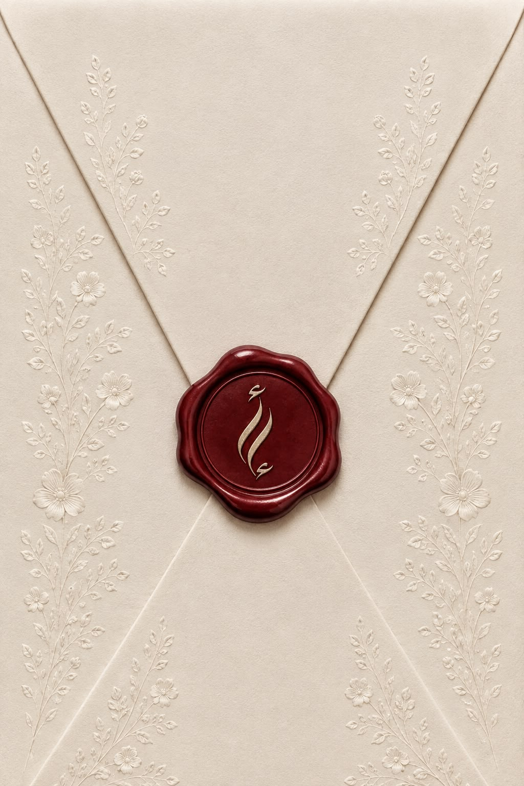
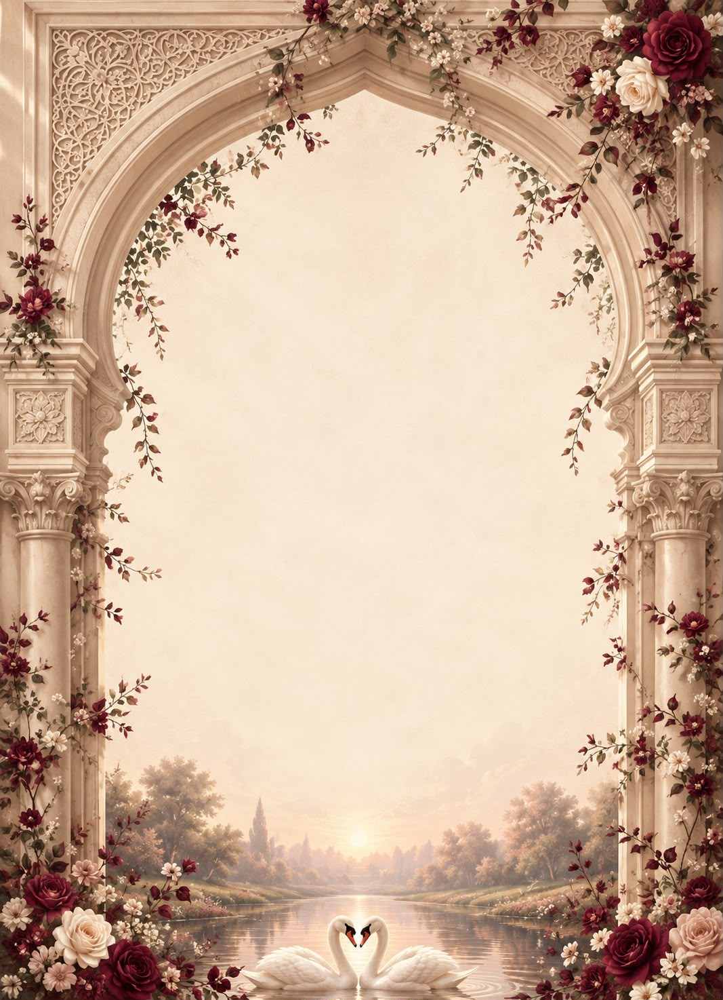

[index.html](https://github.com/user-attachments/files/32480776/index.html)
<!DOCTYPE html>
<html lang="ar" dir="rtl">
<head>
  <meta charset="UTF-8">
  <meta name="viewport" content="width=device-width, initial-scale=1.0">
  <title>دعوة خطوبة | أدهم وإسراء</title>
  
  <!-- Google Fonts -->
  <link rel="preconnect" href="https://fonts.googleapis.com">
  <link rel="preconnect" href="https://fonts.gstatic.com" crossorigin>
  <link href="https://fonts.googleapis.com/css2?family=Amiri:ital,wght@0,400;0,700;1,400&family=Aref+Ruqaa:wght@400;700&family=Tajawal:wght@300;400;500;700&family=Montserrat:wght@400;500;600;700&display=swap" rel="stylesheet">
  
  <!-- FontAwesome Icons -->
  <link rel="stylesheet" href="https://cdnjs.cloudflare.com/ajax/libs/font-awesome/6.4.0/css/all.min.css">

  <!-- Canvas Confetti Library -->
  

  
</head>
<body>

  <!-- صوت خلفية -->
  <audio id="wedding-music" loop preload="auto">
    <source src="music.mpeg" type="audio/mpeg">
  </audio>

  <!-- زر الموسيقى -->
  <button id="music-toggle-btn" class="music-btn" title="تشغيل / إيقاف الموسيقى">
    <i class="fa-solid fa-music" id="music-icon"></i>
  </button>

  

    <!-- شاشة صورة الكرت -->
    

      

        
        

          <i class="fa-solid fa-hand-pointer"></i> اضغط هنا لفتح الدعوة
        

      

    

    <!-- المحتوى الرئيسي -->
    

      <!-- بطاقة الصورة الرئيسية -->
      

        

        

          
بِسْمِ اللَّهِ الرَّحْمَنِ الرَّحِيمِ

          
دعوة حفل خطوبة

          

            كان حلمًا، فأصبح موعدًا… 
            وكان دعاءً، فأصبح نصيبًا 🤍
          

          

            أدهم
            &
            إسراء
          

        

      

      <!-- موعد الحفل -->
      

        
موعد الحفل

        

          
السبت، 24 أكتوبر 2026

          

            <i class="fa-regular fa-clock" style="color: var(--accent-gold);"></i>
            الساعة 6:00 مساءً
          

        

      

      <!-- العداد التنازلي -->
      

        
يبدأ العد التنازلي

        

          

            00
            ثانية
          

          

            00
            دقيقة
          

          

            00
            ساعة
          

          

            00
            يوم
          

        

      

      <!-- موقع الحفل -->
      

        
موقع الحفل

        
قاعة المناسبات السعيدة

        
اسم الشارع، المدينة

        <a href="https://maps.google.com" target="_blank" rel="noopener noreferrer" class="map-preview-btn">
          <i class="fa-solid fa-location-dot" style="color: var(--accent-burgundy);"></i>
          فتح في خرائط جوجل
        </a>
      

      <!-- قسم تهنئة العرسان -->
      

        
اتركلنا أثر بكلمه حلوة ✍️

        

          قبل أن نبدأ فصلنا الجديد 
          اتركوا لنا منكم كلمةً نحتفظ بها للأبد 🤍
        

        
        <form class="congratulations-form" id="congrats-form">
          <input type="text" name="name" class="congrats-input" placeholder="الاسم" required>
          <textarea name="message" class="congrats-textarea" placeholder="اكتب تهنئتك هنا..." required></textarea>
          <button type="submit" class="submit-congrats-btn">
            <i class="fa-solid fa-paper-plane"></i>
            إرسال التهنئة
          </button>
        </form>
      

      

        ننتظركم بشوق لتكتمل فرحتنا بكُم ... 
        
          <small>Made in love for</small> <small>Adham & Esraa</small>
        
      

    

  

  
</body>
</html>
